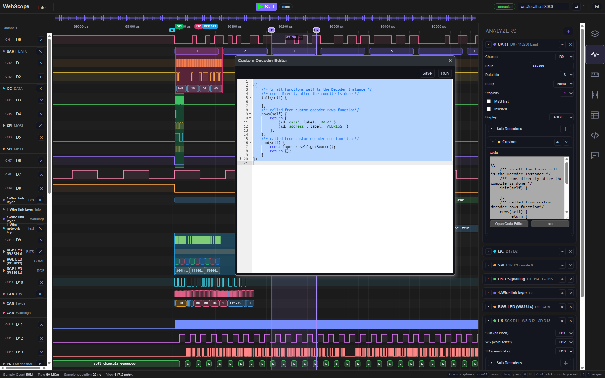
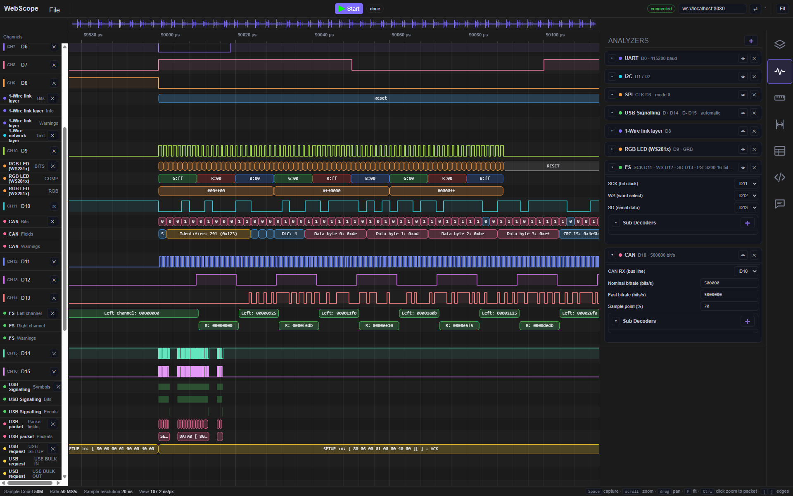
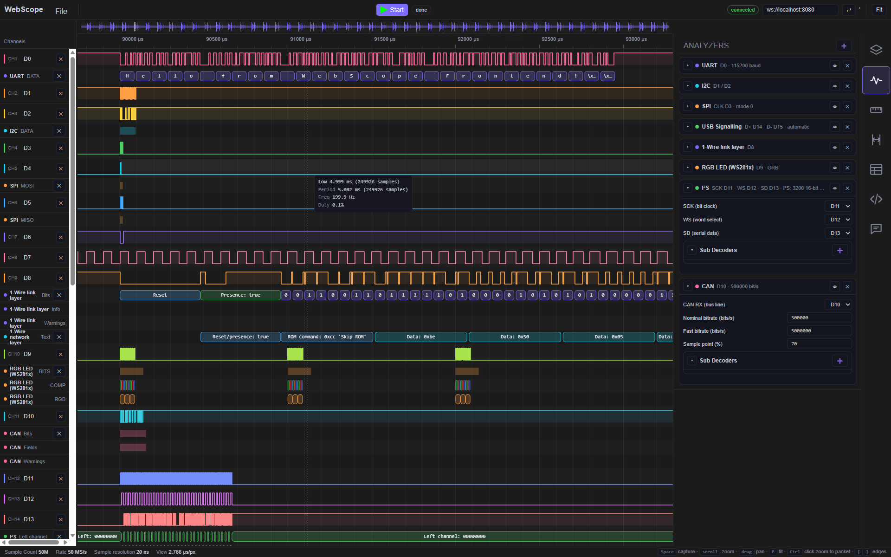
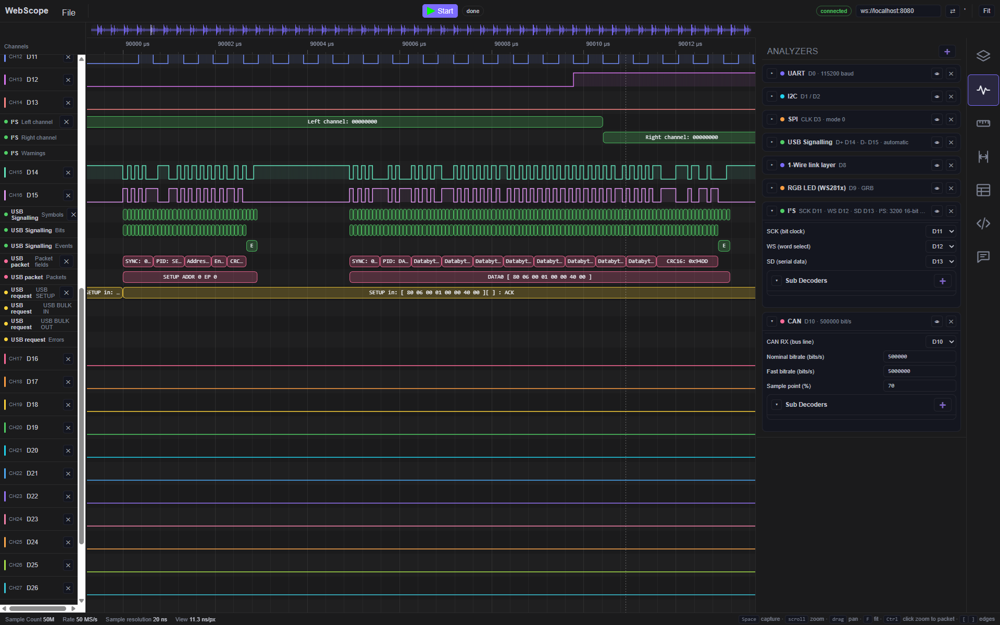
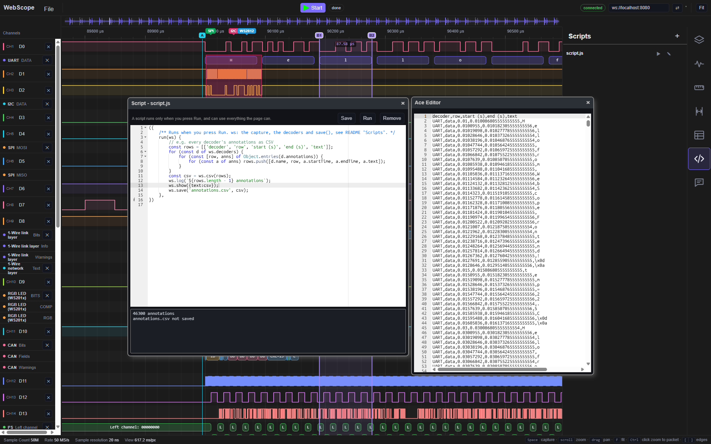
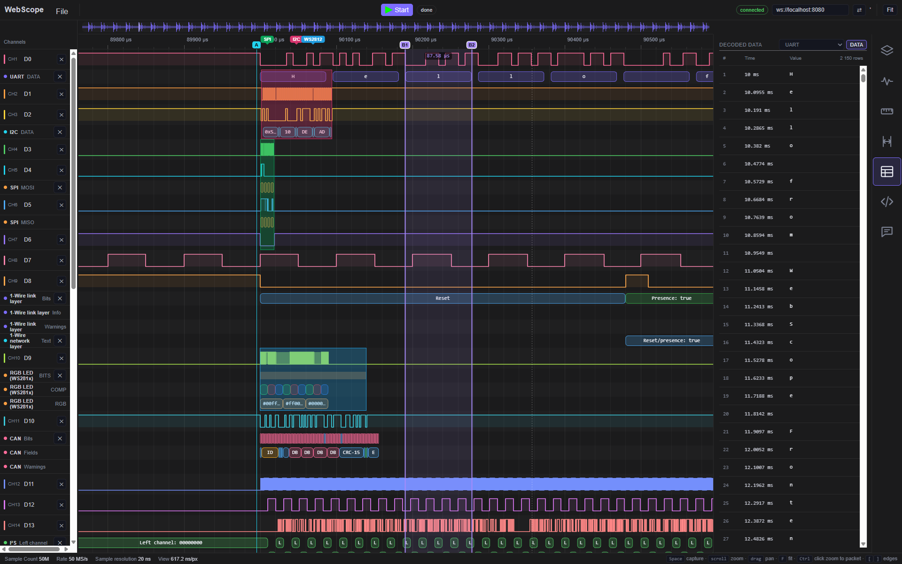

# WebScope

A browser-based logic analyzer GUI.

WebScope runs directly in a web browser and is designed to communicate with a backend that bridges the browser to a physical logic analyzer. The backend can run locally on the same computer and communicate with hardware over USB, or potentially run remotely on a Raspberry Pi or even a small MCU.

## Why?

The idea came from looking at existing logic analyzer software and especially [Edgewise](https://github.com/mtharrison/edgewise).

Edgewise is a modern logic analyzer project with a Rust backend and a graphical frontend. It showed that a relatively lightweight logic analyzer could provide a much more modern workflow than traditional tools.

I wanted to take that idea in a different direction:

* Run the GUI directly in a web browser.
* Keep the hardware interface separate from the GUI.
* Allow the capture backend to run on another computer or embedded device.
* Keep protocol decoding in the frontend.
* Make decoders easy to extend and chain together.
* Make decoded data available for export and further processing.
* Support importing captures directly instead of being tied to a particular hardware backend.
* Maybe most importantly, I want a non-bloated solution with far fewer dependencies.


This also makes it possible to use the same frontend with very different backends. A backend could be a native USB driver on a PC, a Raspberry Pi connected to a logic analyzer, or eventually a small MCU acting as a capture gateway.

## Based on Edgewise

WebScope is directly based on code from [mtharrison/edgewise](https://github.com/mtharrison/edgewise).

The initial implementation started as a port and adaptation of the Edgewise code, particularly its waveform/capture concepts and demo source. From there, the architecture is being changed toward a browser-based frontend with a separate capture backend.

This project should therefore be considered a derivative work rather than an unrelated implementation of the same idea.

Please see the original Edgewise repository and its license for the original project's licensing and attribution information.

## Getting started

The backend is a small Node.js program (Node 18 or newer). It serves the frontend and talks to the hardware.

```sh
cd backend
npm install
npm start              # or: node index.js --open --port 8080
```

Then open <http://localhost:8080>. The frontend connects to the backend's WebSocket on the same port (the address field in the top bar, `localhost:8080` by default; see [URL parameters](#url-parameters) to use another backend).

The only dependencies are `ws` (WebSocket), `serialport` (USB serial boards) and `open` (`--open`). The frontend has no build step and no dependencies.

### Backend settings

Every setting can be given on the command line or in a `settings.json` next to `index.js` (`backend/settings.json`), which the backend reads at startup when it exists; `--settings <file>` reads another file. The command line wins over the file, and the lists on the command line add to the ones in the file. `backend/settings.example.json` is an example; `backend/settings.json` is not committed (`.gitignore`), so your own settings stay out of git.

| `settings.json` | Command line | Default | What it does |
|---|---|---|---|
| `port` | `--port <n>` | `8080` | Port for the page, the WebSocket and the files |
| `open` | `--open` | `false` | Opens the browser at startup |
| `allowOrigins` | `--allow-origin <origin>` (repeatable) | `[]` | Web pages hosted elsewhere that may use this backend, see [Frontend hosted elsewhere](#frontend-hosted-elsewhere) |
| `allowHosts` | `--allow-host <name>` (repeatable) | `[]` | More names this backend may be reached by, see [Host check](#host-check) |
| `hostCheck` | `--no-host-check` | `true` | Turns the host check off |
| `allowDelete` | `--no-delete` | `true` | `false`: files and folders cannot be deleted through the backend (they can still be made, saved, renamed and moved); the file dialog greys out Delete |
| `sigrokCli` | | | Full path to `sigrok-cli`, when it is not on `PATH` or in a usual install folder (env `SIGROK_CLI`) |
| `logicAnalyzerHosts` | | `[]` | WiFi LogicAnalyzer boards to look for, e.g. `["192.168.1.20:4045"]` (env `LOGICANALYZER_HOSTS`, comma separated) |
| | `--settings <file>` | `backend/settings.json` | Reads the settings from another file |
| | `--allow-admin` | | Lets the backend run as root/administrator, see [Not as root or administrator](#not-as-root-or-administrator) (command line only) |

```json
{
    "port": 8080,
    "allowOrigins": ["https://webscope.example.com"],
    "allowHosts": ["scope.example.com"],
    "logicAnalyzerHosts": ["192.168.1.20:4045"]
}
```

`SIGROK_CLI` and `LOGICANALYZER_HOSTS` still work as environment variables, and win over `settings.json` when they are set. The backend prints the settings file it used and the allowed origins and names at startup.

The backend tests run with `npm test` in `backend/`.

### URL parameters

The frontend reads two settings from the page URL, so the same page can be pointed at another backend without changing any code:

| Parameter | Default | What it does |
|---|---|---|
| `ws` | `localhost:8080` | The capture backend's WebSocket: `host:port`, or a full `ws://…` / `wss://…` address. Without a scheme the page adds `ws://`, or `wss://` when the page itself is loaded over `https`. The address field in the top bar shows it and can change it; ⇄ reconnects. |
| `fsapi` | `/api/fs` | Where the file dialog reads and writes the backend's files (projects, captures, what scripts save). A path on the same server, or a full URL to another one. |

Examples:

```text
http://localhost:8080/?ws=192.168.1.50:8080
    the page from this PC, captures from the backend on a Raspberry Pi at 192.168.1.50

http://192.168.1.50:8080/?ws=192.168.1.50:8080
    the page served by the Pi itself, opened from another computer, a tablet or a phone
    (without ?ws= the page would look for a backend on the viewer's own localhost)

http://localhost:8080/?ws=192.168.1.50:8080&fsapi=http://nas.local:9000/api/fs
    captures from the Pi, files kept on another server
```

Typical uses:

* **Remote hardware**: the logic analyzer hangs off a Raspberry Pi (or another small computer) next to the device under test, and you look at it from your desk.
* **One frontend, several backends**: switch between benches by changing `ws`, e.g. one bookmark per bench.
* **Shared files**: point `fsapi` at one file server so several benches save their projects to the same place.

A file server for `fsapi` has to answer the same requests as the backend's own (`backend/index.js`):

| Request | What it does |
|---|---|
| `GET <fsapi>/<path>` | A file, or for a folder a JSON list of `{ name, isDir, size }` |
| `PUT <fsapi>/<path>` | Writes the request body to a file |
| `DELETE <fsapi>/<path>` | Removes a file, or a folder only when it is empty (409 otherwise) |
| `MKCOL <fsapi>/<path>` | Makes a folder (409 when it exists) |
| `MOVE <fsapi>/<path>` with header `Destination: <fsapi>/<new path>` | Renames or moves a file or a folder; never overwrites (412 when the name is taken) |

`MKCOL` and `MOVE` are the WebDAV methods for the same things. The file dialog uses them for New folder, Rename (F2), Delete (Del, always confirmed) and for dragging files and folders onto a folder. An `Allow` header on the answers (e.g. `Allow: GET, HEAD, PUT, MKCOL, MOVE` without `DELETE`) tells the dialog what the server does not allow. When the server is on another origin than the page, it also has to send CORS headers (`Access-Control-Allow-Origin`, `Access-Control-Expose-Headers: Allow`, and answer the `OPTIONS` preflight for the methods above). A WebScope backend does this for the origins given with `--allow-origin`.

### Frontend hosted elsewhere

The frontend is plain files, so it can also be hosted on any web server, e.g. a public `https` site, and still capture from a backend on your own computer or local network.

By default a backend only accepts its own pages: a page from another origin cannot use its WebSocket or its files, so a random web site you visit cannot drive your hardware. Name the sites you trust when starting it (the option can be given more than once):

```sh
node index.js --allow-origin https://webscope.example.com
node index.js --allow-origin "*"        # any page: only on a network you trust
```

An origin is scheme, host and port, exactly as the browser sends it: `https://webscope.example.com`, no path and no trailing `/`. A refused page is logged by the backend with the option that would allow it. In `settings.json` the same is `"allowOrigins": ["https://webscope.example.com"]`.

### Host check

The backend also checks the name it was reached by (the browser's `Host` header). It answers only to this computer's own names: `localhost`, `127.0.0.1`, `::1`, `*.localhost`, its computer name (also with `.local`) and the addresses of its network interfaces. This stops *DNS rebinding*: a web site that points its own name at your computer's address, so that its page counts as the backend's own page. The browser still sends the site's name, so the backend refuses it.

Reaching the backend by another name, e.g. a DNS name for the Pi or a reverse proxy's domain, needs that name added (without the port):

```sh
node index.js --allow-host scope.example.com
```

A refused name is logged with the option that would allow it. `--no-host-check` (`"hostCheck": false`) turns the check off, e.g. behind a reverse proxy that does its own checks; without it, pages on other sites can reach the backend through DNS rebinding. A reverse proxy has to pass the browser's `Host` on (nginx: `proxy_set_header Host $host;`, Caddy does by default), or the backend sees the proxy's name.

These checks only keep *web pages* from using the backend behind your back. They are not a password: any program on the computer or the network can still connect.

### Not as root or administrator

The backend refuses to start as root (Linux, macOS) or as an elevated administrator (Windows). It checks that a file in `user_data_fs` really is inside it, and then reads or writes it. In between, anyone who can write in `user_data_fs` can swap a folder for a symlink (on Windows, a junction, which needs no admin rights) to a file only root may open. Run as root, the backend would then read or write that file for them. Run as a normal user, it can only open what that user already can.

On Linux the serial ports need the user in the `dialout` group (`uucp` on Arch), not `sudo`:

```sh
sudo usermod -aG dialout $USER      # then log out and in again
```

(Testing under WSL: USB devices are passed in from Windows with [usbipd-win](https://github.com/dorssel/usbipd-win).)

`--allow-admin` starts it anyway, with a warning; only when no one else can write in `user_data_fs`.

A page loaded over `https` may not open a plain `ws://` connection (mixed content), with one exception:

| Backend | From an `https` page |
|---|---|
| Same computer | `?ws=ws://localhost:8080` works in Chrome, Edge and Firefox, which treat `localhost` / `127.0.0.1` as secure. Write the `ws://`: without it the page uses `wss://`, which the backend does not speak. Safari blocks it. |
| Another computer | Needs `wss://`, i.e. TLS with a certificate the browser trusts, e.g. the backend behind a reverse proxy (Caddy, nginx) that does TLS. The backend has no TLS of its own yet. |

Chrome may also ask once for permission before a public site can reach addresses on your local network.

## Architecture

```text
                    Web Browser
                 ┌───────────────┐
                 │    WebScope   │
                 │               │
                 │ Waveform UI   │
                 │ Decoders      │
                 │ Data export   │
                 └───────┬───────┘
                         │
                 HTTP / WebSocket
                         │
                 ┌───────▼───────┐
                 │    Backend    │  backend/index.js (Node.js)
                 │               │
                 │ Device drivers│  one file per kind of device
                 │ SW trigger    │  backend/trigger.js
                 └───────┬───────┘
                         │
                 USB serial / TCP / sigrok-cli
                         │
                 ┌───────▼───────┐
                 │ Logic Analyzer│
                 └───────────────┘
```

The backend captures the data and streams it to the browser over the WebSocket. The browser keeps the whole capture in its own memory, draws it and runs the decoders on it.

The backend sends every sample in the same format, whatever the device: **bit n = channel n**, 1, 2 or 4 bytes per sample (little endian). The width depends on the highest captured channel (up to channel 8, 16 or 32). The bits of channels that were not captured are 0. Each driver turns its device's own format into this one (`backend/channels.js`).

## How capturing works

All capture settings are in the **Capture** panel on the right:

* **Device**: the device selector at the top. It lists the devices the backend found; ↻ looks for devices again. *Device Information* (*Device Settings* when the device has settings) shows what is known about the device, and its settings, see [Device settings](#device-settings).
* **Channels**: one chip per channel. A chip that is on is captured. A chip is the same setting as the channel's row in the waveform, so hiding a row turns its chip off and the other way round. The channel-count selector turns on the first 1, 2, 4, 8, 16, 24 or 32 channels.
* **Samplerate**: the rates the device supports.
* **Mode**:
  * **Looping** keeps capturing until stopped and keeps the newest samples that fit in the memory buffer.
  * **One shot** captures until the memory buffer is full (or until stopped).
  * **Timer** captures for a set time.
  * **Trigger** waits for a rising edge, falling edge, high pulse or low pulse on one channel, optionally only while other channels are high or low, and keeps a set time before and after the trigger.
* **Memory buffer size**: how much browser memory Looping and One shot may use.

The panel works out what the device can do with the current settings *before* the capture starts. Modes and trigger types the device cannot do are grayed out, and a note under the mode tabs gives the limit, e.g. *Fits the board's buffer (219,644 samples = 2.2 ms at 100 MS/s): works at any samplerate*. The note turns orange when the settings will not work as they are. Each device driver describes its limits (`limits` in its device info), and `frontend/js/capture/captureLimits.js` does the calculation.

### Memory use

A sample takes 1, 2 or 4 bytes in the browser, **chosen by the highest captured channel**, also when the channels below it are not captured. Capturing CH5–CH12 takes 2 bytes per sample, the same as CH1–CH16. To fit the most samples, connect signals to the lowest channels. The note under the memory buffer size shows how many samples fit with the current selection.

### Channels after a capture

The waveform always lists all of the device's channels. Channels you hide are collected under *Show x hidden* in the gutter. When you turn on a channel that is not in the capture on screen, its row stays empty and the gutter tags it **not captured**: it will be in the next capture. The capture on screen is only replaced by a new capture or a loaded file. Switching to another device keeps it.

### Decoders

Decoders run in the browser on the capture on screen: UART, I²C, SPI, I²S, CAN / CAN-FD, 1-Wire (link and network layer), RGB LED (WS281x), USB signalling / packet / request, USB Power Delivery, and a custom decoder you can write in JavaScript. A decoder's channel lists only offer active channels. When a decoder reads a channel without data (not active, or not in the capture), its card says so and the Analyzers tab shows an orange dot.

**Python (sigrok)** runs sigrok's protocol decoders (Python, unchanged) in the browser with [Pyodide](https://pyodide.org): add it, then choose the decoder (e.g. `uart`, `i2c`, `eeprom24xx`) and its channels and options in its card. Python decoders stack on each other as in sigrok (e.g. I²C → 24xx EEPROM), and a custom decoder can stack on one. The decoders are in `python_decoders/` (sigrok's, plus your own in `python_decoders/user/`), the Python runtime in `python_runtime/`; both are served by the Node backend and only downloaded when a Python decoder is used. Decoding runs in a Web Worker, so the page stays responsive. See `python_decoders/README.md`.

### Python decoders: their output

What a Python decoder hands on (to a custom decoder stacked on it, and to scripts as `ws.decoders[i].output`) is what the sigrok decoder sends as `OUTPUT_PYTHON`: one entry per `put()`, in the order the decoder made them (not sorted):

```js
{ start, end, data, type }
```

| Field | |
|---|---|
| `start`, `end` | sample numbers, as in the annotations |
| `data` | the sigrok decoder's own Python data, as JSON |
| `type` | `data[0]` when `data` is a list that starts with a text (almost every decoder does), so you can filter on `f.type === 'DATA WRITE'`; missing otherwise |

From Python to JavaScript: tuples and lists become arrays, `None` becomes `null`, `bytes` an array of numbers, `NaN` / `inf` a text, any other object the text of its `repr()`.

**What `data` holds is up to each sigrok decoder.** Its `pd.py` describes it at the top, under *OUTPUT_PYTHON format*, e.g.:

- [`i2c`](python_decoders/sigrok/i2c/pd.py): `[<ptype>, <pdata>]`, e.g. `['DATA WRITE', 0x3c]`, `['ADDRESS READ', 0x51]` (the address without the R/W bit), `['START', null]`
- [`uart`](python_decoders/sigrok/uart/pd.py): `[<ptype>, <rxtx>, <pdata>]` with rxtx 0 = RX, 1 = TX, e.g. `['DATA', 0, [65, [[bit, start, end], ...]]]`, `['FRAME', 0, [65, true]]`
- [`spi`](python_decoders/sigrok/spi/pd.py): `['DATA', mosi, miso]` (`null` for a channel that is not used), `['CS-CHANGE', old, new]`, `['TRANSFER', [[start, end, value], ...], [...]]` (MOSI, MISO). In Python a transfer holds `Data(ss, es, val)` named tuples: in JavaScript they are plain arrays, without the field names

A custom decoder on top of a Python I²C decoder, showing the bytes written:

```js
({
    init(self) {},
    rows(self) { return { bytes: { label: 'Bytes' } }; },
    run(self) {
        const frames = self.getSource();   // the I²C decoder's output
        return {
            bytes: frames.filter((f) => f.type === 'DATA WRITE')
                         .map((f) => ({ start: f.start, end: f.end, class: 0, text: f.data[1].toString(16) })),
        };
    },
})
```

The same in a script, saving them to a file. Every Python decoder has the type `Python (sigrok)`: find one by `settings.decoder` (`'uart'`, `'i2c'`, ...) or by its name (`I²C (sigrok)`):

```js
const i2c = ws.decoders.find((d) => d.settings.decoder === 'i2c');
ws.save('i2c_writes.bin', Uint8Array.from(i2c.output.filter((f) => f.type === 'DATA WRITE'), (f) => f.data[1]));
```

A longer example that splits the I²C output into transactions (START .. STOP, with repeated starts) and prints them as `50 W [10] R [BE EF]`: [`ScriptEngine_examples/python_i2c_decoder_output_print.ws.js`](ScriptEngine_examples/python_i2c_decoder_output_print.ws.js).

Good to know:

- `output` is `null` for a decoder that sends no Python output (some only make annotations): nothing can be stacked on it.
- It is `[]` while the decoder is still decoding (its card says *decoding…*). A custom decoder on it runs again by itself when the result is there; run a script once the decoding is done.
- Only `OUTPUT_PYTHON` comes out; sigrok's `OUTPUT_BINARY` and `OUTPUT_META` are not used (yet).
- The annotations (the texts in the waveform) are in `ws.decoders[i].annotations`, as for every decoder.

### Files

WebScope project files (the capture as a sigrok `.sr` file plus the decoder setup and the project's scripts) can be loaded. Captures can be imported from sigrok session files (`.sr`) and Saleae Logic 2 binary files.

### Scripts

The **Scripts** panel on the right lists the project's scripts: small pieces of JavaScript that can export the capture or anything the decoders found, in any format you like. **+** adds a script, **▶** runs it, **✎** opens it in the script editor, **✕** removes it, and double-clicking the name renames it. What a script logs goes to the **Messages** panel (and to the output below its code in the editor); errors are also shown on screen, and the script's row says *error*. Scripts are saved in the project file (`scripts/<name>.js`). A script **only runs when you press ▶ or Run** (Ctrl+Enter in the editor), never by itself when a project is loaded, because it can do everything the page can.

A script is an object with a `run(ws)` function, which may be `async`:

```js
({
    run(ws) {
        const uart = ws.decoders.find((d) => d.type === 'UART');
        return ws.save('uart.bin', Uint8Array.from(uart.output, (f) => f.value));
    },
})
```

Scripts can import data too. This one reads a CSV file with one line per sample and one 0/1 column per channel:

```js
({
    async run(ws) {
        const file = await ws.open(['.csv']);
        if (!file) return;
        const samples = file.text().trim().split('\n').map((line) =>
            line.split(',').reduce((value, bit, ch) => value | (Number(bit) << ch), 0));
        ws.setCapture({ samplerate: 1_000_000, samples, channels: ['CLK', 'DATA'] });
    },
})
```

| `ws.` | What it gives |
|---|---|
| `capture` | the capture on screen: `samplerate`, `length`, `trigger`, `channels` (`index`, `name`, `captured`), `sample(i)` (bit n = channel n), `bit(i, ch)`, `edges(ch, from, to)`, `samples(from, count)`, `time(i)` in seconds; `null` without a capture |
| `decoders` | one entry per decoder: `name`, `type`, `settings`, `annotations` (`{ row: [{ start, end, startTime, endTime, text }] }`), `output` (what it hands to decoders stacked on it, e.g. UART frames; for Python decoders see [Python decoders: their output](#python-decoders-their-output)), `parent` |
| `range` | `{ start, end, selected }`: the selected time range in samples, else the whole capture |
| `save(name, data)` | asks where to save (local download or the backend's files); `data` is text, bytes, or anything else (saved as JSON). A script does not need to `await` it: the run waits for it before it reports *done*, and its errors show in the output |
| `open(extensions)` | asks for a file to read (local or the backend's files), e.g. `await ws.open(['.csv'])`; gives `{ name, ext, bytes, text() }`, or `null` when cancelled |
| `setCapture({ samplerate, samples, channels })` | replaces the capture on screen, like opening a file: `samples` has one value per sample (bit n = channel n), `channels` is a count or a list of names. The decoders run on it, and `ws.capture` / `ws.decoders` show the new data right away |
| `csv(rows)`, `hex(bytes)` | text helpers |
| `log(...)` | a line in the Messages panel (prefixed with the script's name) and in the editor's output |

More example scripts are in [`ScriptEngine_examples/`](ScriptEngine_examples/): paste one into a new script. With `setCapture()` a script can also make a capture of its own, like the demo device but with any signal: [`demowave_custom_signals.ws.js`](ScriptEngine_examples/demowave_custom_signals.ws.js) uses the demo device's signal generator (`DemoWave`) for UART, I²C and SPI, and draws a broken UART frame, a chirp and short glitches edge by edge.

## Devices

| Device | Driver | Needs |
|---|---|---|
| Local demo device | in the browser (`frontend/js/sources/DemoSource.js`) | nothing |
| Remote demo device | in the backend (`backend/DemoDevice.js`) | nothing |
| [gusmanb/logicanalyzer](https://github.com/gusmanb/logicanalyzer) boards | `backend/LogicAnalyzerDevice.js`, talks to the board directly | firmware V6_x |
| [pico-coder/sigrok-pico](https://github.com/pico-coder/sigrok-pico) boards | `backend/PicoCoderSigrokPicoDevice.js`, talks to the board directly | the sigrok-pico firmware |
| Anything [sigrok](https://sigrok.org) supports (fx2lafw / Saleae Logic clones, …) | `backend/SigrokDevice.js`, runs `sigrok-cli` | `sigrok-cli` installed |

Neither Pico driver needs sigrok-cli, and neither changes anything on the board: WebScope uses the firmware as it is.

### Device settings

The button under the device selector opens a window about the selected device: its name, channels, samplerates and description, plus what its driver adds (e.g. a LogicAnalyzer board's firmware version and connection). A device can also have settings of its own; then the button says **Device Settings** and the window has a form for them. Settings a device cannot change right now are shown grayed out with the reason, e.g. the WiFi settings of a LogicAnalyzer board without WiFi. Both demo devices have settings: the channel count, which signals they generate (UART, I²C, SPI, PWM, and on the local one also 1-Wire, WS2812, CAN, I²S and USB) and a few settings of those signals, e.g. the UART text and baud rate. The demo settings last until the backend is restarted (remote) or the page is reloaded (local).

The device describes the form in its device info, the browser draws it, and the backend checks the values again before the device uses them (`backend/deviceSettings.js` has the format). A driver only has to add a `settings` description (and `details` for more information lines) and an `applySettings(values)` function; the frontend needs no changes for a new device.

### gusmanb LogicAnalyzer

A Raspberry Pi Pico (or another board) with the [LogicAnalyzer](https://github.com/gusmanb/logicanalyzer) firmware, on USB (found by its USB id `1209:3020`) or on WiFi (`LOGICANALYZER_HOSTS`).

The board does **not stream**: it captures into its own memory and sends the capture when it is done. That sets its limits:

* **Memory**: on a Pico, 131,072 samples with channels 1–8, 65,536 up to channel 16, 32,768 above, at any samplerate. Timer captures longer than that are shortened (with a warning), One shot fills the memory.
* **No Looping**: it cannot run continuously.
* **Trigger in hardware**: rising and falling edge only, no pulse triggers and no conditions on other channels. The edge trigger really fires on the level: at the first sample where the channel is high (rising) or low (falling), also when it is already at that level when the capture starts.
* **Before the trigger**: at most a tenth of the memory (the LogicAnalyzer software's own limit).
* **Without a trigger** the board starts on its external trigger input (GPIO1 on a Pico) being low, which it is when nothing is connected. If something drives it high, the capture does not start.
* **Samplerates**: 1-2-5 steps up to the board's maximum (the firmware reports it).
* **Stop**: the board only looks for the stop every 2 seconds, so a new capture right after a stop waits until the board is free.

**On WiFi** (a Pico W with the LogicAnalyzer firmware's WiFi build): the board joins your network and listens on a TCP port. Its network settings (network name, password, IP address, port) are set over USB: connect the board with USB, select it and open **Device Settings** (or use the LogicAnalyzer project's own software). The board keeps them in its flash, joins the network with WPA2 and uses the IP address you gave it (no DHCP, so pick a free address in your network). It cannot tell its settings back, so the form shows what was last saved from this backend. On boards without the WiFi build, and on a board connected over WiFi, the settings are shown grayed out with the reason. Then list the board's `ip:port` in `LOGICANALYZER_HOSTS` before starting the backend. The backend opens a TCP connection to it and speaks exactly the same protocol as over USB, so the limits above are the same. The board captures into its own memory first and only then sends it, so WiFi only makes the transfer after the capture slower, not the capture itself. Hosts are tried one after another on every ↻, and a host that does not answer delays the scan by up to 5 seconds.

```sh
LOGICANALYZER_HOSTS=192.168.1.20:4045 npm start                         # Linux / macOS
$env:LOGICANALYZER_HOSTS="192.168.1.20:4045"; npm start                 # Windows PowerShell
```

### pico-coder sigrok-pico

A Raspberry Pi Pico (RP2040 / RP2350) with the [sigrok-pico](https://github.com/pico-coder/sigrok-pico) firmware, found by the Pico SDK's USB id (`2e8a:000a`) when it answers the firmware's identify command. Depending on the firmware build it has 21, 26 or 32 digital channels, named after their pins (GP0, GP1, …). Analog channels are not used.

The board **streams** over USB, so all modes work, with these limits:

* **Samplerate**: 5 kHz – 120 MHz. The firmware's notes: with 8 or more channels it is reliable up to 60 MS/s (the panel warns above that).
* **Timer captures that fit the board's buffer work at any samplerate**: up to 219,644 samples with channels up to D7, 109,052 up to D15, 53,244 above. That is the RP2040's buffer. The board does not say whether it is an RP2350, which has a larger buffer, so WebScope always assumes the smaller one.
* **Everything longer, and Looping, One shot and Trigger, is streamed**: USB gives roughly 400–800 KB/s. With signals that change on every sample that is about 500 kS/s with up to 7 channels, 250 kS/s with 8–14 and 167 kS/s with 15–21 (the firmware's user guide). Newer firmware compresses runs (RLE), so quiet signals stream faster. When the board cannot keep up, it stops the capture: WebScope keeps what arrived and says so. The panel does not gray out rates above the streaming limit yet.
* **Trigger**: the firmware has no trigger of its own, so the backend triggers in software on the stream (`backend/trigger.js`). All trigger types and conditions work, within the streaming limit.
* **Channels**: the firmware needs its channels turned on from D0 upward without gaps, so the driver turns on D0 up to the highest channel you selected and drops the others. It always turns on at least D0–D4: with only D0–D3 the firmware uses a 4-bit mode that returned wrong data on the boards tested (sigrok-cli shows the same).

### sigrok devices

Every device `sigrok-cli --scan` finds is listed, with the samplerates `sigrok-cli` reports. The backend runs `sigrok-cli` for each capture and triggers in software on its stream. Drivers that cannot run until stopped are given a very large sample count instead. Some devices always sample all their channels; WebScope still only shows the channels you selected.

## Decoder architecture

Protocol decoding is intended to be layered.

For example:

```text
Raw samples
    │
    ▼
   I²C
    │
    ▼
 EEPROM
    │
    ▼
 Application protocol
```

A decoder can consume the output of another decoder, allowing arbitrary decoder chains without requiring every possible protocol to be built into the core.

The decoded result can contain both presentation annotations and structured data. This allows decoded information to be displayed, passed to another decoder, or exported independently.

## Current status

This project is under development. The browser frontend, the capture buffer, the decoders and the Node.js backend with the drivers above work.

`backend_rust` is a port of the Node.js backend to a single executable (no Node.js needed): the same WebSocket protocol, `settings.json` and command line options, the same drivers (demo device, sigrok-cli, gusmanb LogicAnalyzer over USB and WiFi, sigrok-pico), the software trigger, the device settings and the Python decoder folders. Build it with `cargo build --release` in `backend_rust` and run `target/release/webscope-backend` (it finds the WebScope folder from its own location or the current folder). `backend_cpp` is an older experiment.

Expect things to change.

## License

WebScope is free software, released under the GNU General Public License, version 3 or (at your option) any later version (`GPL-3.0-or-later`). See [LICENCE](LICENCE).

The parts of WebScope that come from [Edgewise](https://github.com/mtharrison/edgewise) are also covered by Edgewise's MIT license, which has to stay with them. See [LICENSE-EDGEWISE](LICENSE-EDGEWISE).

## Credits

WebScope is based on code from
[mtharrison/edgewise](https://github.com/mtharrison/edgewise).

Copyright © 2026 Matthew Harrison for the original Edgewise code.

Additional code, modifications and new components in WebScope are
Copyright © 2026 Jannik Svensson.

Several protocol decoders (USB, 1-Wire, I²S, CAN) are ported from
[libsigrokdecode](https://github.com/sigrokproject/libsigrokdecode)
(GPL-2.0-or-later). Each of those files keeps the original copyright and
license notice of its authors.

WebScope is released under the GPL-3.0-or-later license.

## images






